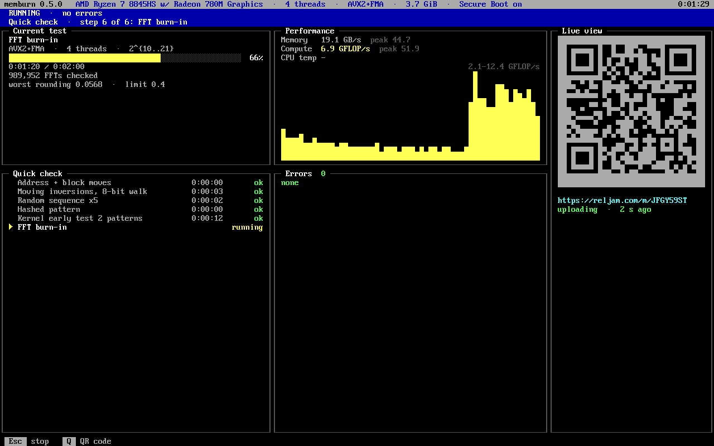
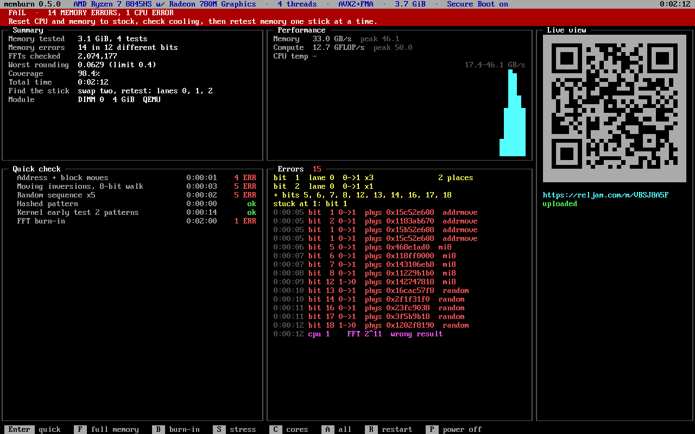
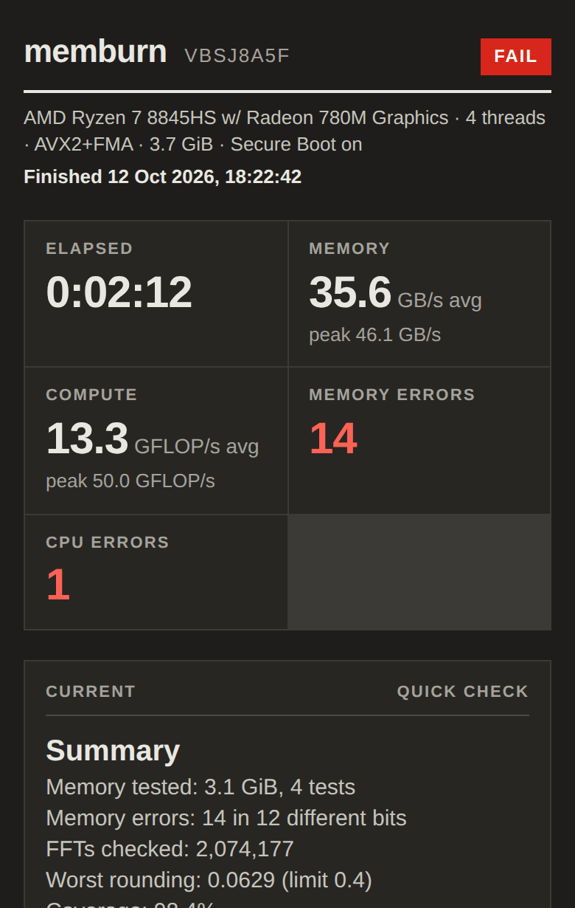
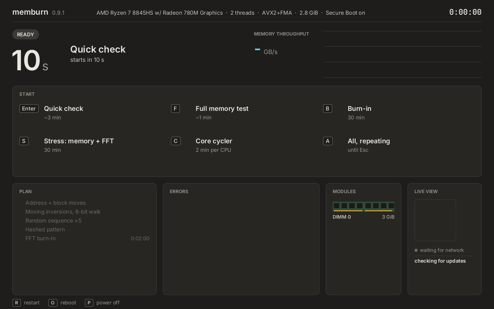
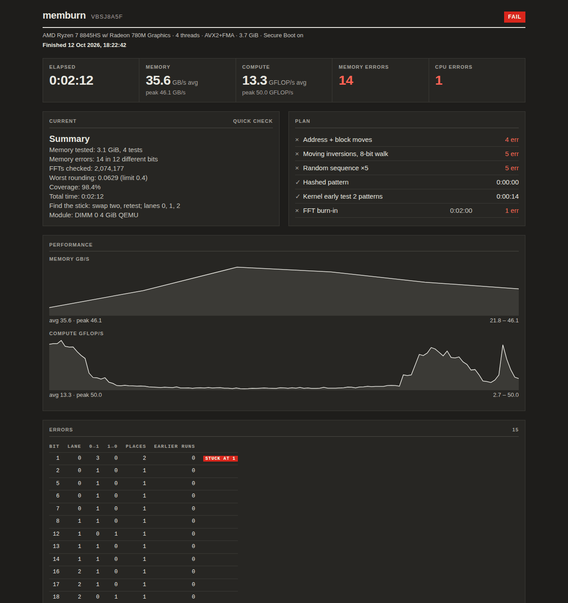

# memburn

Memory test and CPU burn-in on a bootable USB stick.

- A quick check takes about 5 minutes.
- It boots from a USB stick with Secure Boot on. Nothing is installed on the PC.
- It uses every core and nearly all RAM.
- With wired Ethernet, scan the QR code and watch the run on your phone.
- Free and open source, MIT licence.

Download the stick image from [Releases](https://github.com/nincode/memburn/releases/latest) or https://reljam.com/memburn/.



<p>


</p>

## Write the stick

Any USB stick of 128 MB or more. Writing erases everything on it.

| File | For |
|---|---|
| `memburn-<version>-usb.img` | the bootable stick |
| `memburn-<version>.exe` | Windows 10 and 11 |
| `memburn-<version>-linux-x86_64` | Linux |

**Windows, Rufus**

1. Start [Rufus](https://rufus.ie). **Device**: pick the stick.
2. **Boot selection**: *Disk or ISO image*, then **SELECT** and choose `memburn-<version>-usb.img`.
3. Click **START** and confirm that the stick will be erased.

Rufus writes a `.img` byte for byte (DD mode). If it ever asks how to write the image, choose **Write in DD Image mode**.

**Windows, macOS, Linux: [balenaEtcher](https://etcher.balena.io)**: **Flash from file** → the `.img`, **Select target** → the stick, **Flash!**

**Linux, dd**

```sh
lsblk                                          # find the stick, e.g. /dev/sdb (the disk, not sdb1)
sudo dd if=memburn-<version>-usb.img of=/dev/sdX bs=4M conv=fsync status=progress
```

**macOS, dd**

```sh
diskutil list                                  # find the stick, e.g. /dev/disk4 (external, physical)
diskutil unmountDisk /dev/diskN
sudo dd if=memburn-<version>-usb.img of=/dev/rdiskN bs=4m && diskutil eject /dev/diskN
```

A wrong disk name erases that disk. Check the size in `lsblk` or `diskutil list` first.

## Use it

1. Plug the stick in and open the PC's boot menu. The key depends on the board: often F8, F11 or F12, sometimes Esc or F10.
2. Pick the USB stick. GRUB starts `memburn <version>` after 5 s. Linux then tests memory for about 6 s per 16 GiB (`early_memtest=2`) while GRUB's text stays on screen.
3. The menu starts the quick check after 10 s. Press Enter to start it now, or another key below.



| Key | Mode | What it does | Length |
|---|---|---|---|
| Enter | Quick check | Four memory tests, then 2 min of FFT burn-in on every thread | 3–5 min |
| F | Full memory test | Nine memory tests | ~6 s per GiB |
| B | Burn-in | FFT sizes 2^10 to 2^20 on every thread | 30 min |
| S | Stress | Memory test and FFTs at the same time | 30 min |
| C | Core cycler | Small FFTs on one logical CPU at a time | 2 min per CPU |
| A | All, repeating | Full memory test, then 10 min burn-in | until Esc |

| Key | |
|---|---|
| Esc | stop the run after the current step |
| Q | larger QR code |
| R / P | restart / power off, from the menu or result screen |
| U | update now, shown while a newer release downloads or waits |

During memory tests the current-test panel shows the time left in the test and in the whole job, from the measured memory speed. The memory modules panel lists each module's slot, size, speed and part.

The second GRUB entry, `bare-metal UEFI`, needs Secure Boot off. It tests a little more RAM but has no network and no stress mode.

### Read the result

| Banner | Meaning |
|---|---|
| PASS (green) | No errors. |
| FAIL (red) | Memory errors, CPU errors, or both. The second line says what to try. |
| STOPPED EARLY (brown) | Esc before the end, no errors so far. |

Each error shows the time, the flipped bit, its direction (0->1 or 1->0), the physical address and the test. The top of the errors panel sums up each bit: lane, how often it flipped each way, at how many addresses. The same bit at many addresses points to timing or voltage. One address points to a bad cell.

**On memory errors**

1. Reset CPU and memory settings (XMP/EXPO, overclock) to stock, check cooling, and run again.
2. If errors stay, power off and swap two modules between slots.
3. Run the same test. Errors that follow a module mean the module is bad. Errors that stay with the slot point to the slot, the board or the memory settings.
4. Test the last suspect module alone in a known-good slot.

CPU errors (a wrong FFT result) with no memory errors point to the CPU, its cooling or its voltage.

### Files on the stick

The stick shows up as a normal drive on any PC. Its root holds:

| File | |
|---|---|
| `memburn.log` | every run's log: system, modules, errors, summary |
| `memburn-history.txt` | one start and one result line per run; feeds "earlier runs" in the bit table |
| `memburn-crash-<date>.txt` | kernel log after a crash; the stick restarts after 30 s |
| `memburn.cfg.example` | rename to `memburn.cfg` for unattended runs |
| `windows\memburn.exe` | the Windows version |

`memburn.cfg` skips the menu and runs one job. Keys: `mode=quick|mem|burn|both|stress|cores`, `minutes=`, `cycles=` (0 = until Esc), `shutdown=1`, `upload=0`, `update=auto|off`. The example file lists them all.

### Updates

The stick checks for a newer release in the background, as soon as the network is up. It downloads it and checks its signature and every file's hash during the run, without delaying the menu or the test, and installs it after the run: the result screen says `Updated to <version>, used at the next boot`. U (or `update=auto`) starts the new version as soon as it checks out, restarting the test. The previous version stays in the GRUB menu as `memburn <old> (previous)`. Your `memburn.cfg`, log and history are kept. `update=off` turns the check off.

### Privacy

With a network each run gets a page at `reljam.com/m/<id>`, updated every 3 s. Anyone with the link can open it. It holds the CPU model, thread count, RAM size, the memory modules (slot, size, speed, maker, part number, serial) and the test results. Nothing else about the PC is sent. Runs are kept for 30 days.

`upload=0` in `memburn.cfg` turns it off. The CLI takes `--no-upload`.



## Windows and Linux programs

The same dashboard runs inside Windows or Linux. The OS keeps some RAM, so only the stick tests nearly all of it.

**Windows**: run `memburn-<version>.exe` from an administrator terminal so it can lock test memory.

```powershell
.\memburn-<version>.exe                      # menu
.\memburn-<version>.exe -m burn -d 60        # 60 min burn-in
.\memburn-<version>.exe -m mem --mem 90%     # memory test on 90% of available RAM
```

**Linux**: run as root to lock memory and see physical addresses.

```sh
chmod +x memburn-<version>-linux-x86_64
sudo ./memburn-<version>-linux-x86_64                  # menu
sudo ./memburn-<version>-linux-x86_64 -m quick --plain  # one quick check, plain lines
```

`--help` lists every option. Exit codes: 0 pass, 1 errors found, 2 usage, 3 stopped early.

## More

- [docs/DEVELOPMENT.md](docs/DEVELOPMENT.md): build, tests, QEMU, internals, all CLI options.
- MIT licence, see [LICENSE](LICENSE). [THIRD-PARTY.md](THIRD-PARTY.md) lists the crates and the stick's Ubuntu parts (shim, GRUB, Linux, BusyBox) with their licences. Each release attaches their sources.
